# Scam Message Detection

**Streamlit demo:** See [START_HERE.md](START_HERE.md) for setup, included local models and neural checkpoint placement.

Scam message detection across SMS, email and phone dialogue. The project includes traditional classifiers, DistilBERT and bidirectional long short-term memory (BiLSTM) models. It also includes an AI agent that investigates suspicious messages and cites supporting evidence.



*How the agent checks a message (`adaptive_agent` mode, see [Agent backend](#agent-backend)).*

## Project structure

| Path | Content |
|---|---|
| `traditional/` | TF-IDF + LR, NB, word SVM and character SVM training |
| `transformer/` | DistilBERT training, notebooks and inference |
| `recurrent/` | BiLSTM training, notebook and inference |
| `agent/` | Agent runtime, tools, preparation and evaluation commands |
| `analysis/neural/` | Shared neural analysis, notebooks and preserved results |
| `src/` | Shared data processing, defences and compatibility imports |
| `scripts/` | Shared demo commands and compatibility imports for Agent commands |
| `configs/` | Agent runtime configuration |
| `data/` | Raw data, split assignments and processed exports |
| `notebooks/` | Shared data summary notebook |
| `docs/` | Agent design, integration guides and validation reports |
| `tests/` | Automated tests using pytest |
| `app/` | Streamlit demo (`streamlit_app.py`); see [START_HERE.md](START_HERE.md) |

See the [directory guide](docs/PROJECT_STRUCTURE.md) for entry points and compatibility paths.

## Setup

Run commands from the repository root.

| Component | Environment and instructions |
|---|---|
| Main project and traditional classifiers | Python 3.11 with `requirements.txt` |
| Agent backend | Python 3.12 in a separate environment with `requirements-agent.txt`; see the [frontend handoff](docs/agent_frontend_handoff.md) |
| DistilBERT and BiLSTM training | Component guides: [Transformer](transformer/README.md), [Recurrent](recurrent/README.md); [shared experiments](analysis/neural/README.md) |
| DistilBERT inference | Dependencies, model placement and usage in the [prediction interface](transformer/INTERFACE_for_frontend.md) |

Create the main environment with conda:

```sh
set -o pipefail && conda create -n scam-detection python=3.11 -y && conda run -n scam-detection pip install -r requirements.txt
```

Alternatively, create a Python 3.11 virtual environment and install `requirements.txt`. Keep the Agent environment separate: saved Agent models check the package versions recorded during training.

## Data

### Raw datasets

Download each raw dataset from its original source linked below and save it under `data/raw/`. Raw datasets are not included in this repository.

| Dataset | Original source | Save as |
|---|---|---|
| SMS Phishing Dataset (Mendeley) | [Dataset_5971.zip](https://doi.org/10.17632/f45bkkt8pr.1) | `data/raw/mendeley/Dataset_5971.csv` |
| UCI SMS Spam Collection | [UCI dataset page](https://archive.ics.uci.edu/dataset/228/sms+spam+collection) | `data/raw/uci/SMSSpamCollection` |
| Nazario_5, Nigerian_5, CEAS_08, SpamAssassin | [Zenodo dataset](https://doi.org/10.5281/zenodo.8339691) | `data/raw/zenodo/` |
| BothBosu/scam-dialogue | Downloaded by `load_bothbosu()` from Hugging Face at a pinned revision | `data/raw/hf_cache/` |

### Build splits and exports

Only run this when rebuilding processed data from the raw datasets:

```sh
set -o pipefail && python -m src.splits && python -m src.export
```

`src.splits` writes `data/processed/splits.csv` and checks for leakage. `src.export` writes the processed datasets to `data/processed/export/`.

### Split rules

`splits.csv` records train, validation and test membership for seeds 0, 1 and 2. Standard exports store these as `split_seed0`, `split_seed1` and `split_seed2`.

`uci_replication.csv.gz` retains the original UCI row order and duplicates for the published 30/70 protocol. It has no split columns.

| Split | Use for |
|---|---|
| train | Fitting models, TF-IDF vectorisers and other learned steps |
| validation | Hyperparameter selection and threshold tuning |
| test | Final evaluation |

- For cross-dataset experiments E3 and E4, tune on the source dataset's validation split only. Before training, call `remove_overlap(source, target)` from `src/splits.py` to remove source-training overlap with the target test set.
- CEAS_08 contains 2,930 emails from the "THE DAILY TOP 10 from CNN" campaign. They are all in test for seed 0 and train for seeds 1 and 2. Report seed 0 results with and without this campaign, identified by `template` starting with `thedailytop`.
- After retraining on train + validation, re-check the selected threshold on a held-out part of the training data.

## Usage

### Traditional classifiers

| Entry point | Model |
|---|---|
| `traditional/lr_scam.py` | Logistic Regression |
| `traditional/nb_scam.py` | Naive Bayes |
| `traditional/svm_word_scam.py` | Word TF-IDF + Support Vector Machine (SVM) |
| `traditional/svm_char_scam.py` | Character TF-IDF + SVM |

The scripts read preprocessed CSVs. Arguments select the text and label columns, test data and output directory. Each help command runs independently:

```sh
python traditional/lr_scam.py --help
python traditional/nb_scam.py --help
python traditional/svm_word_scam.py --help
python traditional/svm_char_scam.py --help
```

These scripts use their own grouped splits or a supplied test file; they do not automatically apply `splits.csv`. Check that datasets and split protocols match before comparing results.

### DistilBERT and BiLSTM

DistilBERT code is in `transformer/`; BiLSTM code is in `recurrent/`. Shared
threshold, significance, robustness and LIME analyses are in `analysis/neural/`.
Original neural results are preserved under `analysis/neural/results/`.

The DistilBERT prediction interface is `transformer/inference/predict.py`. Model weights are shared separately and are not committed to Git. See the [Transformer guide](transformer/README.md), [BiLSTM guide](recurrent/README.md) and [prediction interface](transformer/INTERFACE_for_frontend.md).

## Tests

Run tests in the environment for the component being checked:

```sh
python -m pytest -q
```

Some tests require separately downloaded raw data or prepared local models.

## Agent backend

The Agent backend combines local classification with adaptive investigation.
It normalises the message and runs a saved classifier selected on validation data.
Ordinary complete messages use the local path without an API call. For long,
near-boundary or incomplete messages, the Agent chooses which sections to read,
when to cross-check or retrieve similar training cases, and whether to ask for
clarification. Results include source-linked evidence, reading coverage and
review decisions.

| Current mode | Behavior |
|---|---|
| `document_classifier` | Deterministic first substantive window + fixed classifier; no API |
| `document_fixed` | Same gate/tools, fixed reading schedule, one LLM finalization on escalation |
| `adaptive_agent` | Same gate, LLM chooses next actions from actual observations |

See the [Agent design and validation record](docs/adaptive_agent_handoff.md) for
the workflow, integration details and recorded provider runs. The backend has
182 passing tests, with seven skips for raw datasets held outside the repository.

For a fresh checkout, use Python 3.12 in the isolated Agent environment, place the
supplied archive in ignored `local_inputs/`, then run:

```sh
python3.12 -m venv .venv
.venv/bin/python -m pip install -r requirements-agent.txt
.venv/bin/python -m scripts.prepare_agent_inputs
.venv/bin/python -m src.agent.baseline
.venv/bin/python -m src.agent.candidates
.venv/bin/python -m scripts.prepare_document_triage
.venv/bin/python -m scripts.frontend_agent_example
.venv/bin/python -m pytest -q
```

Preparation preserves existing artifact directories, so an already prepared
checkout can use them directly. Before live escalation, install the pinned counter
with `python -m scripts.prepare_agent_tokenizer` and configure the provider using
the frontend handoff. Git ignores keys, artifacts and traces. The CLI defaults
to the configured adaptive mode; use `--mode document_classifier` for
an explicitly offline path. The Python service provides the frontend integration interface.

The implementation is grouped in `agent/runtime/` and `agent/scripts/`.
The UI-independent entry point remains `src.agent.service.ScamAgentService`;
`python -m agent` is the direct CLI entry point.
Use the separate `requirements-agent.txt` environment with the delivered splits
to preserve compatibility with the saved models.
See [frontend setup and JSON contract](docs/agent_frontend_handoff.md),
[artifact/data audit](docs/agent_integration_audit.md), and
[tests and provider validation](docs/agent_validation.md).

```sh
.venv/bin/python -m src.agent.cli --text 'Please verify your account immediately.' --channel sms --mode classifier_only
```

The `agent`, `direct_llm` and `fixed_workflow` modes require explicitly configured
`LLM_API_KEY`, `LLM_BASE_URL` and `LLM_MODEL`; otherwise they return a structured
`provider_not_configured` result. Local inputs, artifacts and evaluation traces
remain ignored by Git.

A subsequent bounded [real DeepSeek validation](docs/agent_live_validation.md)
recorded 5 calls and 6,228 tokens on three validation messages: one complete
Agent answer and two local budget stops. The ignored local macOS profile uses
Keychain; no API key is stored in source or YAML.

The [earlier budget repair and acceptance](docs/agent_budget_fix.md) recorded
three real final responses in 9,164 tokens. SMS/phone passed directly; email
retains a visible review flag after deterministic correction of a unique exact
quote's coordinates. Full offline suite: 121 passed, 7 skipped. Run
`python -m scripts.prepare_agent_tokenizer` to install the pinned official
counter data before configured live inference.

A [six-case paired comparison](docs/agent_comparison_pilot.md) evaluated the
classifier, direct LLM, fixed workflow and Agent on the same balanced TEST sample.
The classifier, fixed workflow and Agent each scored 6/6; direct LLM scored 4/6
with two abstentions. The report includes latency, API cost, coverage and
per-case analysis.

The [classifier router extension](docs/classifier_router_report.md) adds
`fixed_model`, `rule_router` and `agent_router` modes. Twelve candidates were
trained on identical canonical TRAIN memberships, with fixed/rule choices from
VAL only. A paired 12-case TEST pilot found 12/12 correct for all three policies;
the Agent used 24 actual requests and 45,839 tokens.
Candidate artifacts and runtime catalogs remain ignored by Git.

An [independent stress/disagreement challenge](docs/router_stress_report.md)
used a VAL-locked design and excluded 105 previously used TEST IDs. On 12 views
from nine new bases, all three routing policies scored 11/12 (4/5 on selected
disagreement inputs). The shared miss was a zero-width-character SMS; alternative
candidates classified it correctly. The report separates challenge strata,
clean/obfuscated pairs, costs and post-hoc diagnostics.

The [normalised boundary pilot](docs/normalised_boundary_report.md) now gives all
three policies the same normalised input and enforces a VAL-calibrated second
classifier near each primary's native decision boundary. Use
`configs/agent.normalised.yaml` for these version-1.2 routing modes. On 12 inputs
from nine new TEST bases, every policy scored 10/12; the two misses are paired
views of one very long email whose common prefix contains mostly addresses.
Rule/Agent guards made eight/six secondary calls and each flagged one correct
decision for review. Agent routing made 24 requests / 55,177 tokens. The report
explains the effect of input clipping and records the measured costs.
No API request is made by `fixed_model` or `rule_router`.
